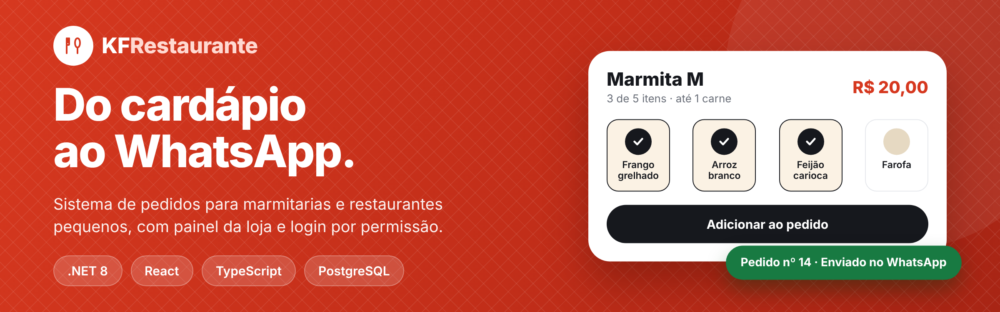
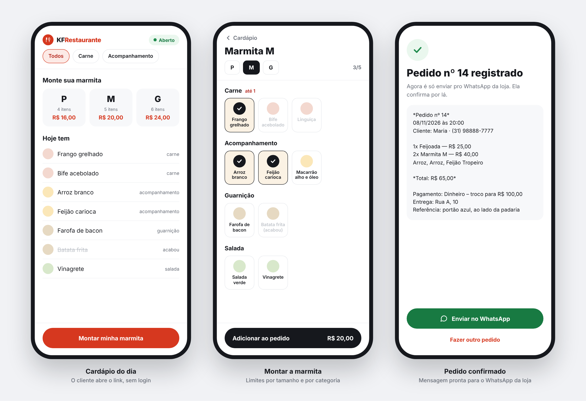
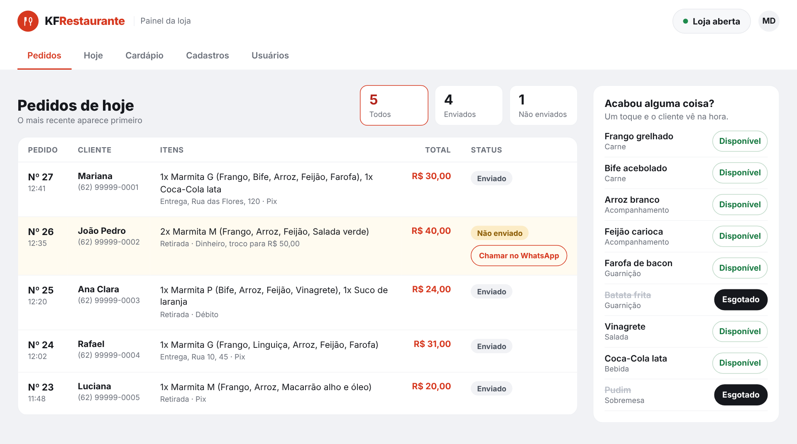
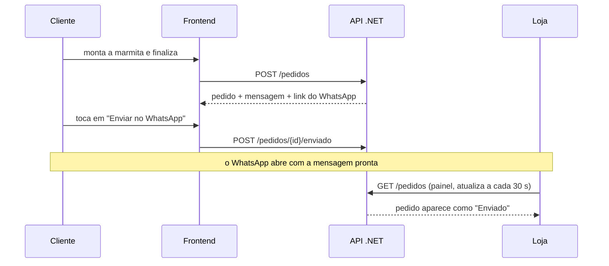

<p align="center">
  
</p>

# 🍱 KF Restaurante: frontend

Oi, eu sou o Karlos e este é o frontend do **KF Restaurante**, um sistema de pedidos para marmitarias e restaurantes pequenos. O cliente abre um link, monta a marmita e o pedido chega pronto no WhatsApp da loja. A loja acompanha tudo num painel, com login e permissões por pessoa.

O backend (.NET 8) fica em outro repositório: [KFRestaurante](https://github.com/karlosdevcs/KFRestaurante). Este aqui é a interface em React que conversa com ele.

<p>
  
  
  
  
  
  
</p>

---

## 📸 Telas

### O cliente pede pelo celular, sem login

<p align="center">
  
</p>

### A loja acompanha os pedidos em tempo quase real

<p align="center">
  
</p>

> As telas acima usam dados de exemplo.

---

## ✨ O que o sistema faz

| Cliente (sem login) | Loja (com login) |
|---|---|
| Vê o cardápio de hoje e se a loja está aberta | Acompanha os pedidos do dia, com filtro por status |
| Monta a marmita respeitando o limite de itens por tamanho e por categoria | Marca o que esgotou, e o cliente vê na hora |
| Pede bebida e sobremesa avulsas | Abre e fecha a loja e define o WhatsApp que recebe os pedidos |
| Escolhe retirada ou entrega, forma de pagamento e troco | Cria, ajusta e publica o cardápio do dia |
| Recebe a mensagem do pedido pronta e abre o WhatsApp da loja com um toque | Cadastra opções, tamanhos e limites por categoria |
| | Gerencia usuários e as permissões de cada um |

---

## 🔄 Como um pedido acontece



A mensagem que a loja recebe vem **pronta da API**: o frontend só mostra o texto e abre o link. Quem monta o formato é o backend, num lugar só.

---

## 🔐 Login e permissões

A loja exige login, e o que cada pessoa vê depende das **permissões ligadas para ela**. O papel (funcionário, dono, superuser) só define quem pode criar e gerenciar quem.

| Permissão | O que libera |
|---|---|
| Ver pedidos | Aba **Pedidos** |
| Marcar esgotado | Botões de disponível e esgotado |
| Abrir e fechar a loja | Botão de abrir e fechar |
| Montar e publicar o cardápio | Aba **Cardápio** |
| Gerenciar opções e tamanhos | Aba **Cadastros** |
| Alterar o WhatsApp da loja | Campo do WhatsApp na aba **Hoje** |
| *Papel Dono ou Superuser* | Aba **Usuários** |

Ao abrir o painel, o frontend chama `GET /auth/eu` para saber quem é a pessoa e quais abas mostrar. As abas e os botões que ela não pode usar **nem aparecem**. Quem protege de verdade é a API: sem token ou sem a permissão, a chamada volta `401` ou `403`, e o frontend trata os dois.

---

## 🧱 Stack

| Camada | Tecnologia |
|---|---|
| Interface | React 18 e TypeScript (`strict`) |
| Build | Vite |
| Estilo | Tailwind CSS 4, com os tokens de design em variáveis CSS |
| Dados do servidor | TanStack Query (cache, polling e invalidação) |
| Rotas | React Router, com a área da loja carregada sob demanda |
| Testes | Vitest, Testing Library e MSW |
| Fonte | Inter, auto-hospedada |

---

## 🧠 Decisões de projeto

**O token fica em `sessionStorage`, não em `localStorage`.** O token é um segredo que o JavaScript consegue ler. Num ataque XSS, o `localStorage` seria lido de qualquer aba e por muito tempo. Com `sessionStorage`, a sessão sobrevive a recarregar a página e morre ao fechar a aba. O custo é entrar de novo ao reabrir o navegador.

**O frontend esconde, a API protege.** Esconder um botão não impede ninguém de chamar o endpoint. Por isso o frontend só usa as permissões para organizar a tela, e trata `401` e `403` quando a API recusa.

**As permissões são relidas o tempo todo.** A API lê as permissões do banco a cada requisição. O frontend acompanha: refaz `GET /auth/eu` quando a janela volta ao foco, a cada 60 segundos e depois de qualquer `403`. Se alguém perde uma permissão, a aba some sem precisar entrar de novo.

**"Enviado" quer dizer que o cliente tocou no botão, não que a mensagem saiu.** O link `wa.me` abre o WhatsApp, mas o sistema não consegue confirmar o envio. A tela usa os rótulos "Não enviado" e "Enviado" sem prometer mais do que isso.

**As regras da marmita existem nos dois lados.** O frontend bloqueia o item que passaria do limite para dar resposta na hora, mas a API continua sendo a autoridade e o erro dela sempre aparece na tela.

**Um bug que só apareceu no navegador de verdade.** Os testes rodam em jsdom, que não processa CSS. Um botão invisível cobria outro e roubava o clique no computador, e os mais de 360 testes passavam. Só rodar a interface contra a API real mostrou. Hoje existe um teste específico para essa regra de CSS.

---

## 🚀 Como rodar

**Pré-requisitos:** Node.js (versão LTS atual) e o [backend](https://github.com/karlosdevcs/KFRestaurante) rodando.

1. **Suba o backend.** Ele precisa do banco, da chave do JWT e dos dados do primeiro superuser configurados no user-secrets. O passo a passo está no README dele. Depois:

   ```bash
   dotnet run --launch-profile KFRestaurante
   ```

2. **Instale e configure o frontend:**

   ```bash
   git clone https://github.com/karlosdevcs/kf-restaurante-frontend.git
   cd kf-restaurante-frontend
   npm install
   cp .env.example .env
   ```

   O `.env` tem uma única variável:

   ```
   VITE_API_URL=http://localhost:5000
   ```

   > Variáveis `VITE_*` vão para o navegador e são públicas. Nunca coloque segredo nelas.

3. **Rode:**

   ```bash
   npm run dev
   ```

   O app abre em `http://localhost:5173`, que é uma das origens que o CORS do backend já libera. Use esse endereço (`127.0.0.1` seria bloqueado). A loja fica em `http://localhost:5173/loja`, e o login é o do superuser criado no backend.

| Script | O que faz |
|---|---|
| `npm run dev` | Servidor de desenvolvimento |
| `npm run build` | Build de produção |
| `npm run preview` | Serve o build localmente |
| `npm run lint` | Análise estática |
| `npm test` | Todos os testes |

Em desenvolvimento existe também o catálogo de componentes em `/_ui`, que não entra no build de produção.

---

## 🗺️ Rotas

| Rota | Acesso | O que abre |
|---|---|---|
| `/` | aberta | Cardápio e montagem da marmita |
| `/montar/:tamanhoId` | aberta | Montar a marmita (celular) |
| `/pedido` | aberta | Meu pedido e finalização (celular) |
| `/confirmacao/:numero` | aberta | Pedido confirmado e botão do WhatsApp |
| `/loja/entrar` | aberta | Login |
| `/loja/pedidos` | Ver pedidos | Pedidos do dia |
| `/loja/hoje` | Abrir e fechar, esgotado ou WhatsApp | Estado da loja e itens esgotados |
| `/loja/cardapio` | Gerenciar cardápio | Criar, ajustar, publicar e fechar o cardápio |
| `/loja/cadastros` | Gerenciar cadastros | Opções, tamanhos e limites |
| `/loja/usuarios` | Dono ou Superuser | Usuários e permissões |
| `/loja/conta` | logado | Minha conta e troca de senha |

---

## 🧪 Testes

Mais de 360 testes com Vitest, Testing Library e MSW (a API é simulada, sem backend no ar). Eles cobrem as regras da marmita, a validação do formulário, o payload do pedido, o login e a sessão, o tratamento de `401` e `403`, as abas por permissão, as regras de hierarquia dos usuários e os fluxos de cliente e loja.

```bash
npm test
```

Além dos testes, a interface foi verificada contra a **API real**, em celular e computador, fazendo pedidos de verdade.

---

## 📁 Estrutura

```
src/
  api/             client central e um arquivo por recurso da API
  components/ui/   componentes base do design (Conceito 2)
  features/
    auth/          login, sessão, permissões e guardas de rota
    cliente/       fluxo do cliente, no celular e no computador
    loja/          painel: pedidos, hoje, cardápio, cadastros, usuários
  lib/             regras puras: marmita, carrinho, formatação, categorias
spec-frontend/     a spec que guiou a construção, dividida em partes
PROGRESSO.md       registro das fases, decisões e lacunas encontradas
```

---

## ⚠️ Limitações conhecidas

- Sem refresh token: o login dura 12 horas e depois é preciso entrar de novo.
- Sem exclusão de opções, tamanhos, cardápios e usuários (a API não tem esses endpoints, só desativar usuário).
- Atualização dos pedidos por polling a cada 30 segundos, sem WebSocket e sem notificação.
- Sem recuperação de senha por e-mail: quem gerencia a pessoa redefine a senha dela.
- Sem foto de prato: as telas usam uma ilustração e cores por categoria.
- Porção dupla de um componente (a API aceita) ainda não existe na interface.

### Lacunas do backend que encontrei

Durante a construção, três pontos do backend ficaram sem solução limpa no frontend. Eu os contornei no front, registrei no [`PROGRESSO.md`](PROGRESSO.md) e depois corrigi no backend:

1. **Cardápio em rascunho não era consultável pelo painel.** Agora a API tem `GET /cardapios/hoje/painel` e `PUT /cardapios/{id}/opcoes`, e o painel deixa ajustar as opções antes de publicar.
2. **`GET /pedidos` devolvia só o resumo.** Agora a lista já traz os itens, e o painel não faz mais uma chamada por pedido.
3. **Mensagens de `401` e `403` vinham só em inglês.** Agora a API manda o `detail` em português.

Uma decisão que continua de propósito: o cliente não consegue recarregar o pedido pela API, porque `GET /pedidos/{id}` exige permissão (abri-lo deixaria qualquer pessoa ler pedidos de outras trocando o número na URL). A confirmação usa a resposta do `POST /pedidos`.

---

## 🧭 Como foi construído

Este projeto seguiu **desenvolvimento guiado por spec**:

1. Desenhei as telas como protótipo clicável, em celular e computador, e escolhi o estilo visual.
2. Escrevi uma spec do frontend, dividida em partes: tokens de design, medidas de cada componente, regras de negócio, contrato real da API lido do código do backend e critérios de aceite.
3. O Claude Code executou a spec em 11 fases, com um commit por fase e testes passando antes de seguir.
4. Cada divergência entre a spec e o código, cada lacuna do backend e cada decisão técnica ficaram registradas em [`PROGRESSO.md`](PROGRESSO.md).

A spec completa está em [`spec-frontend/`](spec-frontend/00-indice.md).

---

## 👋 Autor

**Karlos**

[](https://github.com/karlosdevcs)
